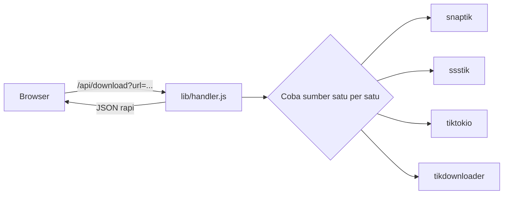

<div align="center">

# LixTik

**Website multifungsi. Homepage jadi pusat navigasi, setiap fitur punya halamannya sendiri.**


</div>

---

## Fitur

| Halaman | Alamat | Isi |
| --- | --- | --- |
| Home | `/` | Pusat navigasi: kartu semua fitur, otomatis dari daftar fitur |
| TikTok Downloader | `/tiktok` | Video tanpa watermark, MP3, slideshow foto |
| Instagram Downloader | `/instagram` | Reel, video, dan foto dari postingan publik |
| Pinterest Downloader | `/pinterest` | Video dan gambar kualitas asli |
| YouTube Downloader | `/youtube` | Video dan audio |
| Twitter / X Downloader | `/twitter` | Video dan gambar dari postingan |
| Facebook Downloader | `/facebook` | Video dari postingan publik |
| Spotify Downloader | `/spotify` | Audio lagu, album, dan playlist (MP3) |
| SoundCloud Downloader | `/soundcloud` | Audio lagu (MP3) |
| Apple Music Downloader | `/applemusic` | Audio lagu dan album (MP3) |
| Bilibili Downloader | `/bilibili` | Video publik |
| Douyin Downloader | `/douyin` | Video tanpa watermark |
| Bandcamp Downloader | `/bandcamp` | Audio lagu dan album (MP3) |
| Pixiv Downloader | `/pixiv` | Gambar kualitas asli |
| Reddit Downloader | `/reddit` | Video dari postingan |
| RedNote Downloader | `/rednote` | Video dan gambar |
| TeraBox Downloader | `/terabox` | File dari link berbagi publik |
| Threads Downloader | `/threads` | Video dan gambar |
| History | `/history` | Semua download dari semua fitur, bisa difilter |
| Panduan | `/panduan` | Cara pakai tiap fitur, dibuat otomatis dari daftar fitur |

Gratis, tanpa login. Empat sumber scraper TikTok punya sistem cadangan: kalau satu gagal, otomatis pindah ke berikutnya.

## Menjalankan di komputer

Butuh Node.js 18 ke atas.

```bash
npm install
npm start
```

Buka `http://localhost:3000`. Ganti port dengan `PORT=8080 npm start`.

## Deploy ke Vercel

1. Upload seluruh folder ke GitHub.
2. Import repo di [vercel.com/new](https://vercel.com/new), lalu klik **Deploy**.

`api/download.js` otomatis jadi endpoint `/api/download`, dan `vercel.json` memberi batas waktu 30 detik.

## Log ke Discord

Setiap pencarian dikirim ke Discord sebagai laporan "LixTik // SYSTEM MONITOR": versi sukses (status 200) dan versi gagal (502 atau 500). Laporan memuat alamat IP klien (untuk memantau penyalahgunaan), sedangkan link TikTok yang dicari tidak ikut dicatat.

Isi variabel berikut (lihat `.env.example`):

| Variabel | Keterangan |
| --- | --- |
| `DISCORD_BOT_TOKEN` | Token bot dari Discord Developer Portal |
| `DISCORD_CHANNEL_ID` | ID channel tujuan. Bot harus sudah diundang dan punya izin **Send Messages** |
| `DISCORD_WEBHOOK_URL` | Opsional. Dipakai kalau token dan channel ID kosong |

Di Vercel, isi lewat **Settings > Environment Variables**. Di komputer sendiri, jalankan dengan `node --env-file=.env server.js` (Node 20.6 ke atas). Jangan pernah mengunggah token ke GitHub; file `.env` sudah masuk `.gitignore`. Kalau variabel kosong, pencatatan dilewati dan website tetap jalan normal.

## Cara kerja



Server mencoba sumber secara berurutan sampai ada yang berhasil, dengan batas 10 detik per sumber dan 25 detik total. Hasilnya diseragamkan di `lib/normalize.js` supaya tampilan nggak bergantung pada sumbernya.

## Struktur proyek

```
.
├── api/, lib/, server.js        # backend: /api/download dan /api/file
├── public/
│   ├── index.html               # homepage (hub)
│   ├── tiktok.html              # satu file HTML per fitur
│   ├── instagram.html
│   ├── pinterest.html
│   ├── history.html
│   ├── panduan.html
│   ├── _template.html           # contoh untuk halaman fitur baru
│   └── assets/
│       ├── css/                 # base, layout, components, pages, home
│       └── js/
│           ├── config.js        # nama situs dan link channel WhatsApp
│           ├── features.js      # DAFTAR FITUR (satu-satunya yang wajib diubah)
│           ├── platforms.js     # pengaturan tiap downloader
│           ├── shell.js         # menu samping, bar atas, boot
│           ├── store.js         # penyimpanan history
│           ├── icons.js         # kumpulan ikon
│           ├── downloader.js    # satu kode untuk semua downloader
│           └── home.js, history.js, guide.js
```

Halaman dibuka lewat alamat bersih (`/tiktok`, bukan `/tiktok.html`). Express memakai `extensions: ['html']`, dan Vercel memakai `cleanUrls` di `vercel.json`.

## Menambah fitur baru

Menu samping, kartu di homepage, dan Panduan semua dibuat dari `assets/js/features.js`, jadi fitur baru tidak perlu mengubah kode yang sudah ada.

**1. Fitur biasa (alat, converter, dan lain-lain)**

1. Tambah satu baris di `LX.features` (`assets/js/features.js`):
   ```js
   { id: 'qr', group: 'alat', title: 'QR Code', pageTitle: 'QR Code Generator',
     desc: 'Buat QR dari teks atau link.', path: '/qr', icon: 'grid', color: '#22d3ee' }
   ```
   Kalau kelompoknya baru, tambah juga di `LX.groups` (contoh `{ id: 'alat', title: 'Alat', desc: '...' }`).
2. Salin `public/_template.html` jadi `public/qr.html`, lalu samakan `data-page="qr"`.
3. Tulis logikanya di `assets/js/qr.js`:
   ```js
   LX.pages.qr = function () { /* isi halaman */ }
   ```
   lalu muat lewat `<script>` di `qr.html`. Selesai: kartu di homepage dan menu samping muncul sendiri.

Beri `soon: true` pada fitur yang belum siap supaya tampil sebagai kartu "Segera" tanpa halaman.

**2. Downloader platform baru (misalnya YouTube)**

1. Tambah entri di `features.js` (`group: 'downloader'`) dan `platforms.js` (nama, `pattern`, `steps`).
2. Salin `tiktok.html` jadi `youtube.html`, ubah `data-page` dan `data-tool` jadi `youtube`.
3. Tambahkan scraper-nya di `lib/` dan arahkan `lib/handler.js` ke sana.

Halaman downloader, Panduan, filter History, dan deteksi "link ini milik platform lain" langsung ikut bekerja.

**3. Mematikan fitur sementara**

Tambah `hidden: true` pada entrinya di `features.js`. Kartu dan menunya hilang, file halamannya tetap ada.

Link channel WhatsApp diisi di `assets/js/config.js` (`whatsappUrl`).

## Troubleshooting

**"Semua server downloader gagal"**: pastikan videonya publik dan linknya benar. Sumber scraper bergantung ke situs pihak ketiga yang bisa berubah atau menolak server tertentu, jadi coba lagi nanti.

**"Server /api/download nggak ketemu"**: halaman dibuka tanpa server. Jalankan `npm start`, atau di Vercel pastikan seluruh folder ikut ter-upload.

**Download gagal untuk video besar di Vercel**: file lewat `/api/file` (proxy dengan batas 150 MB). Vercel punya batas durasi fungsi, jadi video panjang lebih aman dijalankan di Railway, Render, atau VPS.

## Kredit

Scraper TikTok diambil dari [coflyn/scrapr](https://github.com/coflyn/scrapr) (lisensi MIT, salinannya ada di `lib/tiktok/LICENSE`). Platform YouTube, Twitter/X, Facebook, Spotify, SoundCloud, Apple Music, Bilibili, Douyin, Bandcamp, Pixiv, Reddit, RedNote, TeraBox, dan Threads juga memakai modul dari scrapr (lisensi MIT, lihat `lib/scrapr/LICENSE`). Modul yang butuh browser sengaja tidak dipakai karena tidak bisa jalan di Vercel. Sumber `savetik` sengaja dilewati karena butuh browser Chrome yang nggak bisa jalan di Vercel.
