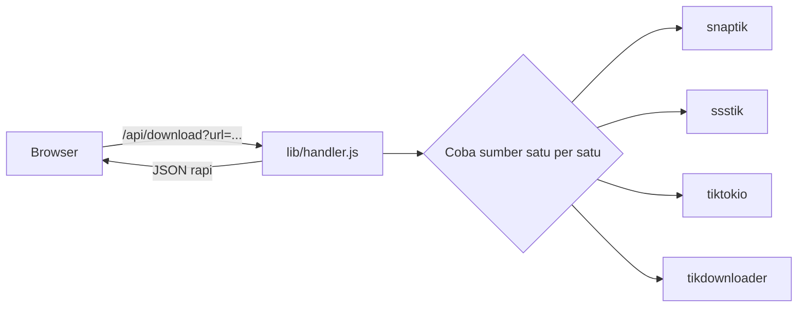

<div align="center">

# LixTik

**Download video TikTok tanpa watermark. Tempel link, pilih MP4 atau MP3.**


</div>

---

## Fitur

- Video TikTok tanpa watermark, termasuk pilihan HD kalau tersedia
- Ambil suara saja dalam MP3
- Postingan foto tampil sebagai slider: download per slide, semua slide dalam ZIP, sebagai video, atau MP3
- Nama file rapi: `LixTik_@username_1791733120369.mp4` untuk video dan `LixTik_1791733104120.webp` untuk foto
- Empat sumber scraper dengan sistem cadangan: kalau satu gagal, otomatis pindah ke berikutnya
- Gratis, tanpa login

## Menjalankan di komputer

Butuh Node.js 18 ke atas.

```bash
npm install
npm start
```

Buka `http://localhost:3000`. Ganti port dengan `PORT=8080 npm start`.

## Deploy ke Vercel

1. Upload seluruh folder ke GitHub.
2. Import repo di [vercel.com/new](https://vercel.com/new), lalu klik **Deploy**.

`api/download.js` otomatis jadi endpoint `/api/download`, dan `vercel.json` memberi batas waktu 30 detik.

## Log ke Discord

Setiap pencarian dikirim ke Discord sebagai laporan "LixTik // SYSTEM MONITOR": versi sukses (status 200) dan versi gagal (502 atau 500). IP klien disamarkan (`103.xxx.xxx.21`), dan link TikTok yang dicari tidak ikut dicatat.

Isi variabel berikut (lihat `.env.example`):

| Variabel | Keterangan |
| --- | --- |
| `DISCORD_BOT_TOKEN` | Token bot dari Discord Developer Portal |
| `DISCORD_CHANNEL_ID` | ID channel tujuan. Bot harus sudah diundang dan punya izin **Send Messages** |
| `DISCORD_WEBHOOK_URL` | Opsional. Dipakai kalau token dan channel ID kosong |

Di Vercel, isi lewat **Settings > Environment Variables**. Di komputer sendiri, jalankan dengan `node --env-file=.env server.js` (Node 20.6 ke atas). Jangan pernah mengunggah token ke GitHub; file `.env` sudah masuk `.gitignore`. Kalau variabel kosong, pencatatan dilewati dan website tetap jalan normal.

## Cara kerja



Server mencoba sumber secara berurutan sampai ada yang berhasil, dengan batas 10 detik per sumber dan 25 detik total. Hasilnya diseragamkan di `lib/normalize.js` supaya tampilan nggak bergantung pada sumbernya.

## Struktur proyek

```
.
├── api/download.js        # endpoint Vercel
├── api/file.js            # endpoint Vercel untuk proxy file
├── lib/
│   ├── handler.js         # logika cari dan cadangan
│   ├── logger.js          # kirim laporan ke Discord
│   ├── report.js          # format laporan SYSTEM MONITOR
│   ├── file.js            # proxy download dengan nama file LixTik_...
│   ├── fileUtils.js       # penjaga alamat dan penamaan file
│   ├── normalize.js       # seragamkan hasil
│   └── tiktok/            # scraper TikTok (dari coflyn/scrapr)
├── public/                # tampilan: index.html, style.css, script.js
├── server.js              # server Express
└── vercel.json
```

## Troubleshooting

**"Semua server downloader gagal"**: pastikan videonya publik dan linknya benar. Sumber scraper bergantung ke situs pihak ketiga yang bisa berubah atau menolak server tertentu, jadi coba lagi nanti.

**"Server /api/download nggak ketemu"**: halaman dibuka tanpa server. Jalankan `npm start`, atau di Vercel pastikan seluruh folder ikut ter-upload.

**Download gagal untuk video besar di Vercel**: file lewat `/api/file` (proxy dengan batas 150 MB). Vercel punya batas durasi fungsi, jadi video panjang lebih aman dijalankan di Railway, Render, atau VPS.

## Kredit

Scraper TikTok diambil dari [coflyn/scrapr](https://github.com/coflyn/scrapr) (lisensi MIT, salinannya ada di `lib/tiktok/LICENSE`). Sumber `savetik` sengaja dilewati karena butuh browser Chrome yang nggak bisa jalan di Vercel.
